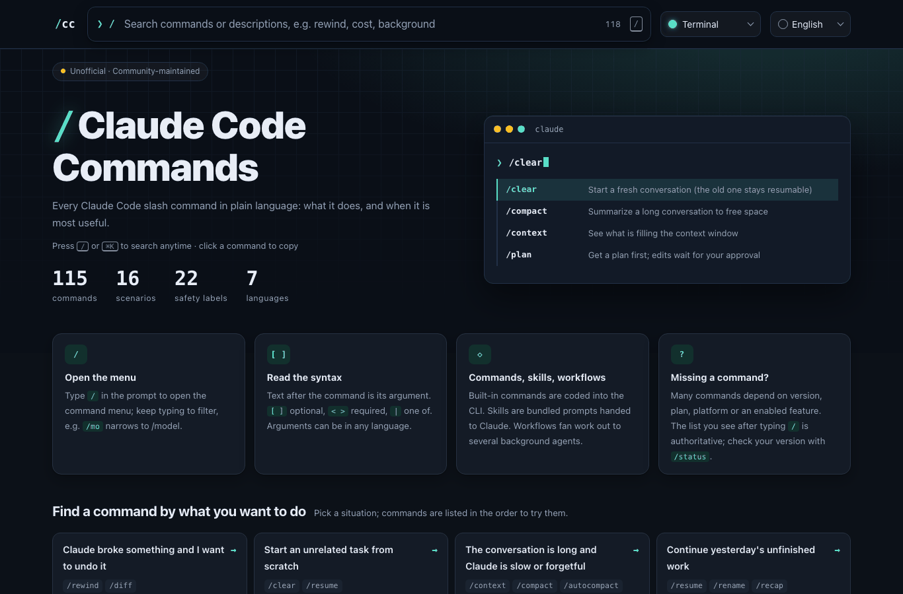
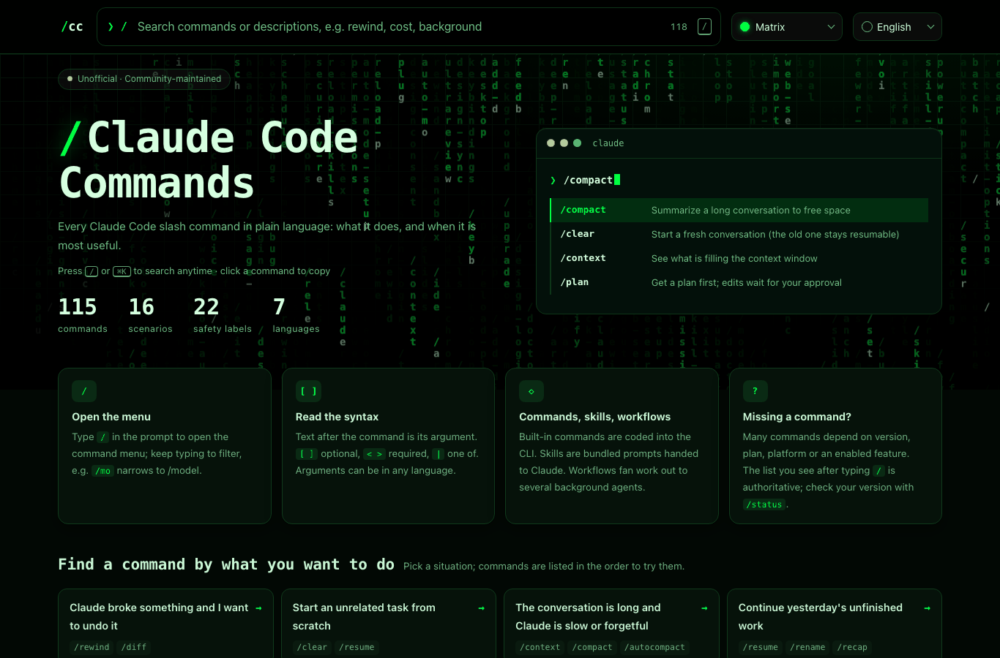
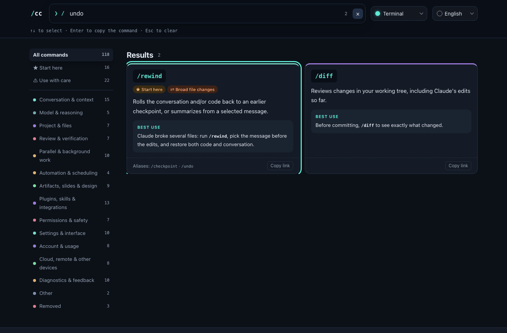
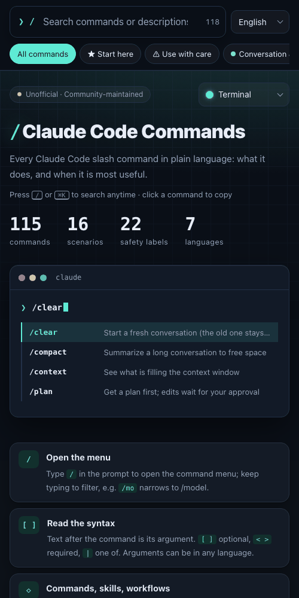

# Claude Code コマンド一覧

[English](README.md) · [日本語](README.ja.md) · [简体中文](README.zh-CN.md) · [繁體中文](README.zh-Hant.md) · [한국어](README.ko.md) · [Русский](README.ru.md) · [Español](README.es.md)

    

> Claude Code のスラッシュコマンドを**英語・日本語・簡体字中国語・繁体字中国語・韓国語・ロシア語・スペイン語の 7 言語**で説明する非公式のリファレンスです。英語の公式ドキュメントが読みにくい方のために、各コマンドの英語の意味、やさしい説明、「いつ使うと便利か」の具体例を載せています。

## ライブプレビュー

すぐに試せる静的ページです。検索、言語やテーマの切り替え、コマンドのコピーができます。インストールは不要です。

### [検索できる Web 版 →](https://futurevolab.github.io/claude-code-commands-i18n/)

| 標準テーマ | マトリックステーマ |
|---|---|
|  |  |

 

## 書き方の読み方

- 入力欄に `/` と打つと一覧が出ます。続けて文字を打つと絞り込めます。
- `[ ]` は省略可、`< >` は必須、`|` は「どれか 1 つ」。引数は日本語で書いてかまいません。
- **スキル**：Claude に渡す決まった手順書。**ワークフロー**：複数のエージェントをバックグラウンドで動かします。
- 多くのコマンドはバージョン・プラン・環境・機能の有効化によって表示が変わります。自分の画面に出る一覧が正です。バージョンは `/status` で確認できます。

## ★ 初心者向け

Claude Code を使い始めた方向けに編者が選んだコマンドです。

- `/clear` · 会話をリセットして新しく始める（前の会話は戻せる）
- `/compact` · 長い会話を要約して空きを作り、続ける
- `/context` · コンテキストを何が埋めているか見る
- `/plan` · 先に計画を出し、承認後に作業する
- `/resume` · 以前の会話に戻る
- `/rewind` · 元に戻す：コードと会話を以前の状態へ
- `/model` · モデルを切り替える
- `/init` · プロジェクトの説明書 CLAUDE.md を作る
- `/code-review` · コミット前にバグを確認し、自動修正も可能
- `/loop` · 一定間隔で指示を繰り返す
- `/mcp` · 外部ツールとの接続を管理する
- `/permissions` · どの操作を確認なしで許可するか決める
- `/usage` · 料金と使用量の上限を確認する
- `/doctor` · 困ったらまず健康診断
- `/help` · ヘルプとコマンド一覧を見る
- `/powerup` · 対話型レッスンで機能を学ぶ

## やりたいことから探す

状況を選んでください。コマンドは試す順に並んでいます。

- **Claude が壊したので元に戻したい** → `/rewind` · `/diff`
- **関係のない別の作業を最初から始めたい** → `/clear` · `/resume`
- **会話が長くなり、遅い・忘れっぽい** → `/context` · `/compact` · `/autocompact`
- **昨日の続きをやりたい** → `/resume` · `/rename` · `/recap`
- **大きな変更の前に、まず計画を見たい** → `/plan` · `/effort` · `/model`
- **Claude にいつも日本語で答えてほしい** → `/init` · `/memory`
- **料金や使用量を節約したい** → `/usage` · `/model` · `/effort` · `/context`
- **コミットや公開の前にチェックしたい** → `/diff` · `/code-review` · `/security-review` · `/verify`
- **複数の作業を同時に / 裏で動かしたい** → `/fork` · `/subtask` · `/background` · `/tasks` · `/batch`
- **繰り返し・決まった時刻に実行したい** → `/loop` · `/schedule` · `/goal`
- **許可の確認ダイアログが多すぎる** → `/permissions` · `/fewer-permission-prompts`
- **外部ツールの接続や機能の追加をしたい** → `/mcp` · `/plugin` · `/skills`
- **スライド・デザイン・グラフを作りたい** → `/slides` · `/design` · `/dataviz` · `/artifacts`
- **パソコンを離れてスマホで続けたい** → `/remote-control` · `/mobile` · `/desktop`
- **Claude Code 自体の調子が悪い** → `/doctor` · `/status` · `/debug` · `/bug`
- **使い方を体系的に学びたい** → `/powerup` · `/help` · `/insights`

## 安全マーク

次のマークが付いたコマンドは特に注意が必要です。

- **¥ 費用が発生する場合あり**: 有料の使用量を消費したり、追加料金が発生したりする場合があります。使う前に `/usage` で確認し、公式の料金説明を確認してください。
- **↗ 外部に送信**: 会話・コード・コメントを他のサービス（Anthropic、GitHub、クラウドセッション、ブラウザー上のサイトなど）に送ったり、リモートに push したりします。内容と送信先を確認してから実行してください。
- **⚿ 機密情報を含む場合あり**: 作られるファイル・クリップボード・レポートに、会話内容・API キー・パスワード・個人情報が含まれる場合があります。共有する前に必ず確認し、該当する部分を削除・伏せ字にしてください。
- **⇄ ファイルを広く変更**: 多くのファイルを一度に変更・復元する場合があります。実行前に Git でコミットかバックアップをし、実行後は `/diff` で確認してください。
- **⚑ 安全設定を変更**: Claude が確認なしで実行できる範囲など、安全に関わる設定を変えます。理解して信頼できる操作だけを許可してください。

## 目次

- [会話とコンテキスト](#会話とコンテキスト) (15)
- [モデルと推論](#モデルと推論) (5)
- [プロジェクトとファイル](#プロジェクトとファイル) (7)
- [レビューと検証](#レビューと検証) (7)
- [並列・バックグラウンド](#並列バックグラウンド) (10)
- [自動化とスケジュール](#自動化とスケジュール) (4)
- [ページ・スライド・デザイン](#ページスライドデザイン) (9)
- [プラグイン・スキル・外部連携](#プラグインスキル外部連携) (13)
- [権限とセキュリティ](#権限とセキュリティ) (7)
- [設定と表示](#設定と表示) (10)
- [アカウントと使用量](#アカウントと使用量) (8)
- [クラウド・リモート・他のデバイス](#クラウドリモート他のデバイス) (8)
- [診断とフィードバック](#診断とフィードバック) (10)
- [その他](#その他) (2)
- [削除済み](#削除済み) (3)

## 会話とコンテキスト

会話の新規作成・圧縮・巻き戻し・再開、Claude の「記憶の容量」の管理

| コマンド | 英語の意味 | 説明 | おすすめの使い方 |
|---|---|---|---|
| `/clear` `[name]` ★ | clear 消去・クリア | コンテキストが空の新しい会話を始めます。プロジェクトの記憶（CLAUDE.md）は残ります。前の会話は削除されず `/resume` で戻れます。名前を付けると前の会話にラベルが付きます。 別名: `/reset`, `/new` | ある機能が終わり、関係のない次の作業に移るとき：`/clear ログイン機能`。前の内容に引きずられず、使用量も節約できます。 |
| `/compact` `[instructions]` ★ | compact 圧縮 | これまでの会話を要約してコンテキストの空きを作り、同じ会話を続けます。「要約で何を残すか」を指示できます。 | 長い会話のあとで：`/compact データベース構造と未修正のバグ一覧を残して`。 |
| `/context` `[all]` ★ | context コンテキスト（Claude が今「覚えている」内容） | コンテキストの使用量と内訳を色付きのマス目で表示し、節約のヒントや容量の警告を出します。`all` で詳細をすべて表示します。 | Claude が「忘れっぽく」なった、使用量の増えが速いと感じたら、まず `/context` で大きなファイルやツール出力が原因か確認します。 |
| `/plan` `[description]` ★ | plan 計画 | プランモードに入ります。Claude はまず調査して計画を示し、承認されてからファイルを変更します。作業内容を添えるとすぐ開始。 | 大きな変更の前に：`/plan ログインのエラーを直して`。計画を確認してから任せます。 |
| `/resume` `[session]` ★ | resume 再開 | ID か名前で以前の会話を再開します。引数なしなら一覧が開きます。バックグラウンドの会話には `bg` と表示されます。 別名: `/continue` | 昨日途中でパソコンを閉じたら：今日 `/resume` で昨日の会話を選んで続きから。 |
| `/rewind` ★ · ⇄ ファイルを広く変更 | rewind 巻き戻し | 会話とコード（片方だけも可）を以前のチェックポイントに戻します。選んだメッセージ以降を要約することもできます。ゲームの「セーブデータを読み込む」に近い機能です。 別名: `/checkpoint`, `/undo` | Claude がファイルを壊してしまったら：`/rewind` で変更前のメッセージを選ぶと、コードと会話がまとめて元に戻ります。 |
| `/autocompact` `[auto\|<tokens>]` v2.1.221 以降 | auto compact 自動圧縮 | コンテキストがどれだけ埋まったら自動圧縮するかを設定します（例：`500k`）。`auto` でモデルの既定値に戻ります。ユーザー設定に保存され、すぐ反映されます。 | 長い作業で圧縮が頻繁に入るのを避けたいとき：`/autocompact 500k`。 |
| `/branch` `[name]` | branch 分岐・ブランチ | 今の時点で会話の分岐を作って切り替え、別の方向を試せます。元の会話は残り `/resume` で戻れます。（Git のブランチではなく会話の分岐です。） | 案 A と案 B で迷ったら：`/branch 案Bを試す`。だめなら元の会話で A を続けます。 |
| `/btw` `[question]` | by the way ところで | 今の会話について、履歴に残さない「ついでの質問」をします。質問なしで実行すると直近の質問と回答を表示します。 | 作業中にエラーの意味だけ知りたいとき：`/btw この 404 は何の意味？`。本題の流れを乱しません。 |
| `/copy` `[N]` | copy コピー | 直前の回答をクリップボードにコピーします。`/copy 2` で 2 つ前の回答。コードブロックがあれば選択画面が出て、一部だけコピーできます。`w` でファイルに書き出し（SSH 接続時に便利）。 | Claude が書いた文章やコマンドを `/copy` でそのまま貼り付け。 |
| `/export` `[filename]` ⚿ 機密情報を含む場合あり | export エクスポート・書き出し | 今の会話をプレーンテキストで書き出します。ファイル名を指定すると直接保存、なしならコピーか保存かを選べます。 | 役に立ったトラブル対応の記録を `/export 対応記録.txt` で保存して共有。 |
| `/goal` `[condition\|clear]` | goal 目標・ゴール | 完了条件を設定すると、条件を満たすか解除されるまで Claude が複数ターンにわたり作業を続けます。引数なしで現在の目標を表示、`clear`・`stop`・`off` などで途中解除。 | `/goal すべてのテストが通る` と設定し、全部通るまで任せます。 |
| `/memory` | memory 記憶・メモリー | 記憶ファイル `CLAUDE.md` の編集、「自動メモリー」のオン・オフ、自動で記憶した内容の確認ができます。 | いつも日本語で答えてほしいなら：`/memory` で CLAUDE.md を開き「常に日本語で回答して」と書きます。 |
| `/recap` | recap 振り返り・要約 | 今のセッションの内容を一文で要約します。 | 会議から戻ってどこまで進んだか忘れたら：`/recap`。 |
| `/rename` `[name]` | rename 名前の変更 | 今のセッションの名前を変え、入力欄の上に表示します。名前なしなら会話内容から自動で付けます。 | 複数のセッションを開いているとき：`/rename 株価バックテスト` にしておくと `/resume` で見つけやすい。 |

## モデルと推論

モデルの切り替え、考える深さや速度の調整

| コマンド | 英語の意味 | 説明 | おすすめの使い方 |
|---|---|---|---|
| `/model` `[model]` ★ | model モデル | AI モデルを切り替え、新しいセッションの既定にも保存します。引数なしで選択画面。対応モデルでは左右キーで推論の深さを調整、行で `s` を押すとこのセッションだけ切り替えます。 | 簡単な修正は速くて安いモデル、難しいバグは `/model opus` で強いモデルに。 |
| `/advisor` `[model\|off]` | advisor アドバイザー | 「アドバイザー」を切り替えます。作業の重要な場面で別のモデルに助言を求めます。`fable`・`opus`・`sonnet` または完全なモデル ID を指定（`fable` は利用権限が必要）。引数なしで選択画面。 | 普段は速いモデルで作業し、重要な判断だけ強いモデルに見てもらう：`/advisor opus`。 |
| `/effort` `[level\|auto\|status\|ultracode [on\|off]]` | effort 努力の度合い（推論の深さ） | 推論の深さを `low`〜`xhigh`、`max`、`auto` から設定します。`status` で現在値を表示。`max` はこのセッションのみ。`ultracode on\|off` で ultracode を切り替えます。 | 再現しにくいバグの調査：`/effort high`、誤字の修正だけ：`/effort low`。 |
| `/fast` `[on\|off]` | fast 高速 | 高速モード（同じモデルで出力が速くなる）を切り替えます。応答中でも切り替えられますが、進行中のターンは元の速度のまま終わります。料金は公式の fast mode の説明を確認してください。 | 急ぎで大量に生成したいとき `/fast on`、急がないときは `/fast off`。 |
| `/output-style` `[style]` v2.1.269 以降 | output style 出力スタイル | 出力スタイル（回答の書き方）を一覧表示・切り替えします。例：`/output-style concise`。 | まず引数なしの `/output-style` で一覧を見て、自分に合うもの（例：簡潔なもの）を選びます。 |

## プロジェクトとファイル

プロジェクトを Claude に理解させる、フォルダーを追加する、変更を確認する

| コマンド | 英語の意味 | 説明 | おすすめの使い方 |
|---|---|---|---|
| `/init` ★ | initialize 初期化 | プロジェクトを読み込んで `CLAUDE.md`（プロジェクトの説明書）を作ります。以降の新しい会話は毎回これを読みます。Codex や Gemini CLI の設定があれば `/import` での移行を提案します。 | 新しいプロジェクトでまず `/init`。そのあと `/memory` で「日本語で答えて」などの希望を追記します。 |
| `/add-dir` `<path>` | add directory フォルダーの追加 | このセッションで別のフォルダーへのアクセスを追加します（作業場所はそのまま）。パスの途中まで入力すると候補が出て `Tab` で確定。追加したフォルダーの `.claude/` 設定はほとんど読み込まれず、ネットワークパスの多くは追加できません。 | フロントとバックエンドが別フォルダーなら：`/add-dir ../backend` で両方を見せます。 |
| `/cd` `<path>` | change directory フォルダーの移動 | 会話を残したまま、セッションを別のフォルダーに移します。`/add-dir` との違い：`/cd` は引っ越し、`/add-dir` は入り口を一つ増やすイメージです。 | 違うフォルダーで始めてしまったら：`/cd ~/projects/website` でやり直し不要。 |
| `/diff` | difference 差分 | 作業ツリーの変更（Claude がこれまでに行った編集を含む）を確認します。 | 「できました」と言われたら、コミット前に `/diff` で中身を自分の目で確認。 |
| `/import` `[codex\|gemini\|cursor] [--dry-run] [--yes]` ⇄ ファイルを広く変更 | import インポート・取り込み | OpenAI Codex・Google Gemini CLI・Cursor の設定（指示ファイル、MCP サーバー、コマンド、サブエージェント、スキル）を取り込みます。`--dry-run` はプレビューのみ。一部のクラウド環境では使えません。Cursor からの取り込みには v2.1.265 以降が必要です。 | Cursor から移るとき：まず `/import cursor --dry-run` で内容を確認してから本番の取り込み。 |
| `/insights` | insights インサイト・分析 | このマシンでの最近の使い方（よく使うプロジェクト、使い方、つまずきやすい点、試すとよい機能）を分析した HTML レポートを作ります。クラウドセッションでは使えません。 | しばらく使ったら `/insights` で、まだ使っていない便利な機能を見つけます。 |
| `/team-onboarding` ⚿ 機密情報を含む場合あり | team onboarding チームへの新人受け入れ | 過去 30 日のセッション・コマンド・MCP の使い方を分析し、新しいメンバーが最初のメッセージとして貼り付けられる Markdown のガイドを作ります。 | 新メンバーが来たら：`/team-onboarding` でガイドを作って渡します。 |

## レビューと検証

バグ・脆弱性の検出、コード整理、実際に動かして確認

| コマンド | 英語の意味 | 説明 | おすすめの使い方 |
|---|---|---|---|
| `/code-review` `[low\|medium\|high\|xhigh\|max\|ultra] [--fix] [--comment] [--max-findings n\|all\|default] [pr#\|branch\|path]` ★ · スキル · ¥ 費用が発生する場合あり · ↗ 外部に送信 · ⇄ ファイルを広く変更 | code review コードレビュー | 現在の変更（または指定した PR・ブランチ・パス）に正しさのバグがないか調べます。深さを選べ、`--fix` で修正まで、`--comment` で GitHub PR／GitLab MR にコメント、`ultra` でクラウドの詳細レビュー。 別名: `/review` | コミット前に：`/code-review high --fix`。他人の PR なら：`/code-review high 1234`。 |
| `/run` スキル | run 実行 | プロジェクトのアプリを起動・操作して、変更の実際の動きを見ます。 | `/run` でサイトを起動し、新しいトップページのスクリーンショットを見せてもらう。 |
| `/run-skill-generator` スキル | skill generator スキル生成 | このプロジェクト専用のスキルを書き、`/run` と `/verify` にクリーンな環境からのビルド・起動・操作方法を教えます。 | 起動手順が複雑（先に DB を起動など）なら一度実行。以後は `/run` だけで済みます。 |
| `/security-review` | security review セキュリティレビュー | 現在のブランチとリモートの既定ブランチの差分から、インジェクション・認証の問題・データ漏えいなどの危険を探します。`origin` リモートが必要です。 | ログイン・決済・個人情報に関わる変更を公開する前に一度実行。 |
| `/simplify` `[target]` スキル · ⇄ ファイルを広く変更 | simplify 簡素化 | 4 つのレビューエージェントが並行して、変更したコードを再利用・簡素化・効率・抽象度の観点で確認し、修正まで行います。正しさのバグは対象外（それは `/code-review`）。 | 動くようになったあと、保守しやすくしたいとき：`/simplify`。 |
| `/ultrareview` `[PR or branch]` ¥ 費用が発生する場合あり | ultra review 超詳細レビュー | クラウドのサンドボックスで複数エージェントによる詳細レビューを行います。推奨は `/code-review ultra`（`/ultrareview` は別名）。Pro・Max・Ultra は 3 回無料、その後は使用量クレジットが必要です。 | 重要なリリースの前に：`/code-review ultra`。 |
| `/verify` スキル | verify 検証 | アプリを実際にビルド・起動して結果を観察し、変更が意図どおりか確認します（テストや型チェックだけに頼らない）。手動で呼んだときだけ動きます。 | ボタンの動作を変えたら：`/verify` で実際に開いて押して確認。 |

## 並列・バックグラウンド

複数の Claude を同時に動かす、バックグラウンドで実行する

| コマンド | 英語の意味 | 説明 | おすすめの使い方 |
|---|---|---|---|
| `/agents` | agents エージェント | 新しいバージョンでは案内が表示されるだけです：Claude にサブエージェントの作成・管理を頼むか、`.claude/agents/` を直接編集します。v2.1.197 以前は管理画面が開きます。 | 「テスト専門のサブエージェントを作って」と頼むだけで OK。 |
| `/background` `[prompt]` | background バックグラウンド | 今のセッションをバックグラウンドのエージェントとして動かし続け、ターミナルを空けます。最後の指示を添えることもできます。確認は `claude agents`。 別名: `/bg` | 30 分かかる作業なら：`/bg 終わったら結果を report.md に書いて`。 |
| `/batch` `<instruction>` スキル · ⇄ ファイルを広く変更 | batch 一括処理 | 大規模な変更を並列で行います。コードを調べて 5〜30 の独立した単位に分けて計画を示し、承認後は単位ごとにバックグラウンドのサブエージェントが独立した worktree で実装・テスト・反映します。Git リポジトリ（または対応する hook）が必要です。 | `/batch src/ を JavaScript から TypeScript に移行`。 |
| `/fork` `[prompt]` | fork フォーク（複製） | 今の会話を新しいバックグラウンドセッションに複製し、こちらは作業を続けます。指示を付けると複製がすぐ作業開始。複製は通常、自分用の worktree を作ってから編集します。 | 機能 A の作業中に小さな不具合も直したいとき：`/fork フッターのずれを直して`。 |
| `/list-agents` v2.1.224 以降 | list agents エージェント一覧 | Claude がメッセージを送れるサブエージェント・チームメイト・他のセッションと、その名前を一覧表示します。セッション間メッセージが有効な場合のみ。 別名: `/peers` | 複数のセッションで連携するとき、お互いの名前を確認。 |
| `/stop` | stop 停止 | 接続中のバックグラウンドセッションを停止します（記録と worktree は残ります）。止めずに離れたいだけなら `/exit` か `←`。 | バックグラウンドの作業が方向違いになったら：`/stop`。 |
| `/subtask` `<task>` | subtask サブタスク | 会話全体を引き継いだバックグラウンドのサブエージェントに作業を任せ、終わると結果がこの会話に戻ります。`/fork` との違い：`/subtask` は結果が戻り、`/fork` は独立したセッションです。 | `/subtask これらの API のドキュメントを書いて`、自分はコードを書き続けます。 |
| `/tasks` | tasks タスク | このセッションのバックグラウンド作業（完了したサブエージェントを含む）を確認・管理します。 別名: `/bashes` | テストやサブエージェントを裏で動かしている間に `/tasks` で進み具合を確認。 |
| `/workflow-authoring` スキル | workflow authoring ワークフローの作成 | 動的ワークフローのスクリプトを書くための資料を読み込みます。通常は Claude が自動で読み込みます。保存済みスクリプトを手で直す前に実行するとよいでしょう。動的ワークフローが有効な場合のみ。 | 保存したワークフローを手で調整する前に。 |
| `/workflows` | workflows ワークフロー | ワークフローの進行画面を開き、実行中・完了済みのワークフローの確認・一時停止・再開・保存ができます。 | 大きな調査や改修のワークフローを動かしているとき、進み具合を見るのに使います。 |

## 自動化とスケジュール

一定間隔で繰り返す、決まった時刻に実行する、PR を自動修正する

| コマンド | 英語の意味 | 説明 | おすすめの使い方 |
|---|---|---|---|
| `/loop` `[interval] [prompt]` ★ · スキル | loop ループ・繰り返し | セッションが開いている間、指示を繰り返し実行します。間隔を省略すると Claude がペースを決め、指示を省略すると組み込みの保守用プロンプトか `loop.md` を実行します。セッションを閉じると止まります。 別名: `/proactive` | `/loop 5m デプロイが終わったか確認`。パソコンを閉じても動かしたいなら `/schedule`。 |
| `/autofix-pr` `[prompt]` ↗ 外部に送信 | auto-fix PR PR の自動修正 | 現在のブランチの PR をクラウドセッションが見張り、CI の失敗やレビューコメントがあれば修正を push します。`gh` CLI とクラウドセッションの利用権が必要です。 | lint だけ任せたいなら：`/autofix-pr lint と型エラーだけ直して`。 |
| `/deep-research` `<question>` ワークフロー | deep research 詳細リサーチ | マルチエージェントのワークフローです。Web を広く検索し、情報源を取得・照合して、出典付きのレポートにまとめます。バックグラウンドで動きます。 | `/deep-research 主要な AI 動画生成ツールの料金と画質の比較`。 |
| `/schedule` `[description]` | schedule スケジュール | クラウドの定期実行タスク（旧 routines）を作成・変更・一覧・実行します。会話形式で設定でき、最近の実行結果も聞けます。Console の API キーでは使えません。 別名: `/routines` | `/schedule 平日の毎朝 9 時に新しい issue をまとめて`。 |

## ページ・スライド・デザイン

共有できるページ、スライド、デザイン、グラフを作る

| コマンド | 英語の意味 | 説明 | おすすめの使い方 |
|---|---|---|---|
| `/artifact-capabilities` スキル | artifact capabilities アーティファクトの機能 | アーティファクトで使える実行時機能（コネクターの呼び出し、ファイルのダウンロード提供など）と、自分のアカウントで使えるものの資料を読み込みます。通常は Claude が自動で読み込みます。 | 複数人が入力できる申込ページを作る前に。 |
| `/artifact-diagramming` スキル · v2.1.221 以降 | artifact diagramming アーティファクトの図解 | アーティファクトで図を描くためのガイドを読み込みます。図が必要な場面、何を描くか、明暗どちらのテーマでも見やすい SVG の書き方。 | わかりやすいシステム構成図がほしいとき。 |
| `/artifacts` | artifacts アーティファクト（共有できる Web ページ） | 自分が持っている、または共有されたアーティファクト（Web ページ）を一覧表示し、セッションへの追加・ブラウザーで開く・リンクのコピーができます。対応環境のみ。 | 先週作ったダッシュボードを探して続きを編集。 |
| `/dataviz` `[request]` スキル | data visualization データ可視化 | グラフ作成のガイドです。データに合う形を選び、役割ごとに色を割り当て、付属スクリプトで色覚多様性への配慮とコントラストを確認します。 | `/dataviz この月次売上表を推移グラフにして`。 |
| `/design` `[brief]` スキル · v2.1.265 以降 | design デザイン | UI のラフ、画面遷移、LP、ポスターを 1 枚のキャンバスに描きます（Claude Design のアーティファクト）。デスクトップのブラウザーで編集し、PNG・PDF で書き出せます。Bedrock や Vertex などでは使えません。 | `/design 家計簿アプリの設定画面`。 |
| `/design consent` | consent / revoke 同意 / 取り消し | Claude Design へのアクセスを許可・取り消します。Claude の返答で `/design consent` を求められたら、自分で入力してください。 別名: `/design revoke` | 許可を求められたら自分で `/design consent` と入力。 |
| `/design-login` | design login デザインのログイン | `/design-sync` 用に claude.ai アカウントで認可します。`/design-sync` や `/design consent` に求められたときに使います。 | `/design-sync` にログインを求められたら実行。 |
| `/design-sync` `[hint]` スキル · ↗ 外部に送信 | design sync デザインの同期 | リポジトリの React デザインシステムを変換して Claude Design にアップロードし、実際のコンポーネントでデザインできるようにします。初回は全コンポーネントを検証するため、大きなリポジトリでは数時間かかることも。アップロード先の claude.ai/design は 2026 年 12 月 14 日までに終了予定です。 | 自社のコンポーネント集があるなら：`/design-sync Acme DS`。上記の終了日に注意。 |
| `/slides` `[brief]` スキル · v2.1.265 以降 | slides スライド | 説明をもとに Claude Slides のプレゼン（アーティファクト）を作ります。アーティファクト対応のセッションと Slides テンプレートが必要です。 | `/slides 四半期の業績レビュー、8 枚、経営層向け`。 |

## プラグイン・スキル・外部連携

Claude に新しい機能を追加：プラグイン、スキル、MCP、ブラウザー、エディター

| コマンド | 英語の意味 | 説明 | おすすめの使い方 |
|---|---|---|---|
| `/mcp` `[reconnect (<server>\|all)\|enable\|disable [<server>\|all]]` ★ | MCP (Model Context Protocol) Model Context Protocol（外部ツール連携の標準） | MCP サーバーの接続と OAuth 認証を管理します。引数なしで一覧、`reconnect`・`enable`・`disable` とサーバー名か `all` で直接操作。 | コネクターのエラーや再ログインが必要なとき：`/mcp reconnect all`。 |
| `/chrome` | Chrome Chrome ブラウザー | Claude in Chrome の設定を行います。 | Chrome 拡張と初めて接続するとき。 |
| `/claude-api` `[subcommand]` スキル | Claude API Claude の API | プロジェクトの言語に合った Claude API と Managed Agents の資料を読み込みます。コードが `anthropic` を import していると自動で有効。サブコマンドは `migrate`・`upgrade`・`api-version`・`cost-optimize`・`build-eval`・`prompt-audit` など。 | 自作 AI アプリの API 費用を下げたい：`/claude-api cost-optimize`。 |
| `/claude-in-chrome` `[task]` スキル · ↗ 外部に送信 | Claude in Chrome Chrome で動く Claude | Claude in Chrome 拡張を通して、ページのテスト・フォーム入力・コンソールログの確認などをブラウザーで行います。Chrome 連携の有効化（例：`claude --chrome`）が必要です。 | `/claude-in-chrome ローカルのサイトで会員登録の流れを試してエラーを報告して`。 |
| `/ide` | IDE (integrated development environment) 統合開発環境（コードエディター） | VS Code や JetBrains などのエディターとの連携を管理し、状態を表示します。 | エディターに Claude の変更が出ないとき、接続を確認。 |
| `/install-github-app` ↗ 外部に送信 · ⚑ 安全設定を変更 | install GitHub app GitHub アプリのインストール | リポジトリに Claude GitHub App を入れ、必要なら GitHub Actions のワークフローとシークレットも設定します。github.com のリポジトリのみ。 | GitHub の issue や PR で @claude と呼んで作業させたいとき。 |
| `/install-slack-app` | install Slack app Slack アプリのインストール | Claude の Slack アプリを入れます。ブラウザーが開き OAuth 認可を行います。 | チームが Slack から Claude を呼びたいとき。 |
| `/plugin` `[subcommand]` | plugin プラグイン | プラグイン（コマンド・スキル・エージェント・ツールのセット）を管理します。引数なしでメニュー、`list`・`install`・`enable`・`disable` で直接操作。案内が出たら `/reload-plugins`。 | `/plugin` でマーケットプレイスを見て、仕事に合うものを入れます。 |
| `/plugin-authoring` スキル · v2.1.287 以降 | plugin authoring 拡張の作成 | 「mod」（Claude の画面や動作を変える小さな拡張）を書くための資料を読み込みます。組み込みプラグインのスキルで、`/plugin` でオフにできます。 | 常に横に表示される小さなパネルを作りたいとき。 |
| `/reload-plugins` `[--force]` | reload plugins プラグインの再読み込み | 再起動せずにプラグインの変更を反映し、読み込み数とエラーを報告します。読み込む MCP ツールが変わる（プロンプトキャッシュが無効になる）場合は警告して中止、`--force` で強制。 | プラグインを入れて再読み込みを促されたとき。 |
| `/reload-skills` | reload skills スキルの再読み込み | スキルとコマンドのフォルダーを再スキャンし、セッション中に追加・変更したスキルをすぐ使えるようにします。増減の数も表示。 | 自作スキルを書いたばかりで、再起動せずに使いたいとき。 |
| `/skill-doctor` v2.1.252 以降 | skill doctor スキルの健康診断 | 各スキルのコンテキスト消費量と使用頻度を表示し、オフにしてよいスキルを見つけます。 | 定期的に実行して、使っていないスキルを整理。 |
| `/skills` | skills スキル | 使えるスキルを一覧表示し、名前・説明・提供元で絞り込めます。`t` でトークン数順、`Space`/`Enter` で Claude や `/` メニューへの表示を切り替え、`Esc` で保存して閉じます。 | スキルが多すぎるとき：`/skills` で `t` を押して並べ替え、使わないものを非表示に。 |

## 権限とセキュリティ

Claude にできること・事前確認が必要なことを決める

| コマンド | 英語の意味 | 説明 | おすすめの使い方 |
|---|---|---|---|
| `/permissions` ★ · ⚑ 安全設定を変更 | permissions 権限 | ツール権限の「許可・確認・拒否」ルールを管理します。範囲ごとの確認、ルールの追加・削除、作業ディレクトリの管理、「Recently blocked」タブ（自動モードが止めた操作）と分類ルールの確認ができます。 別名: `/allowed-tools` | 毎回「npm test を実行してよいか」と聞かれるのが面倒なら、ここで許可に。 |
| `/auto-mode-setup` ⚑ 安全設定を変更 | auto mode setup 自動モードの設定 | プロジェクトと最近のセッションから `autoMode.environment` の項目を下書きし、確認後ユーザー設定に保存します。自動モードの判断精度が上がります。バージョンとプランの条件あり。 | 自動モードがいつもの操作を誤って止めるとき。 |
| `/fewer-permission-prompts` スキル · ⚑ 安全設定を変更 | fewer permission prompts 確認ダイアログを減らす | 履歴からよく使う読み取り専用の Bash・MCP 呼び出しを探し、優先度順にプロジェクトの `.claude/settings.json` の許可リストへ追加します。 | 確認ダイアログで何度も止められるときに一度実行。 |
| `/hooks` | hooks フック（決まったタイミングで自動実行されるスクリプト） | フックの設定を確認します。 | フックのせいで編集のたびにエラーが出ていそうなとき、設定内容を確認。 |
| `/privacy-settings` | privacy settings プライバシー設定 | プライバシー設定を確認・変更します。Pro・Max・Ultra のみ。 | データの扱いに関する設定を確認したいとき。 |
| `/sandbox` ⚑ 安全設定を変更 | sandbox サンドボックス（隔離環境） | サンドボックスモードを切り替えます。対応プラットフォームのみ。 | よく知らないスクリプトを動かす前にオンに。 |
| `/update-config` `[request]` スキル · ⚑ 安全設定を変更 | update config 設定の更新 | 設定の変更（コマンドの許可、環境変数、フックの追加）を言葉で伝えると、Claude が該当の `settings.json` を編集します。テーマやモデルは `/config`。 | `/update-config ファイル編集のたびに prettier を自動実行`。 |

## 設定と表示

テーマ、色、ステータスライン、ショートカット、音声入力

| コマンド | 英語の意味 | 説明 | おすすめの使い方 |
|---|---|---|---|
| `/color` `[color\|default]` | color 色 | このセッションの入力欄の色を設定します：`red`・`blue`・`green`・`yellow`・`purple`・`orange`・`pink`・`cyan`。`default` で戻し、引数なしでランダム。 | 本番環境を扱うセッションは `/color red` にして注意を促す。 |
| `/config` `[key=value ...]` | config 設定 | 設定画面（テーマ、モデル、出力スタイルなど）を開きます。`key=value` で直接変更も可能（例：`/config theme=dark`）。`/config --help` で使えるキーを表示。 別名: `/settings` | `/config theme=dark` で一発でダークテーマに。 |
| `/focus` | focus フォーカス表示 | フォーカス表示を切り替えます。最後の指示、ツール呼び出しの 1 行要約、最終回答だけを表示。フルスクリーン表示でのみ使えます。 | 途中経過は見ず、結果だけ見たいとき。 |
| `/keybindings` | keybindings キー割り当て | キーボードショートカットの設定ファイルを開きます。 | よく使う操作を慣れたキーに変更。 |
| `/scroll-speed` | scroll speed スクロール速度 | マウスホイールの速度を調整します。フルスクリーン表示のみ、JetBrains のターミナルでは不可。 | 一回で飛びすぎるときに遅く。 |
| `/statusline` | status line ステータスライン | 下部のステータスラインを設定します。表示したい内容を言葉で伝えるか、引数なしでシェルのプロンプトから自動設定。 | `/statusline 現在のモデルと git ブランチを表示`。 |
| `/terminal-setup` | terminal setup ターミナルの設定 | VS Code・Cursor・Devin Desktop・Alacritty・Zed で Shift+Enter の改行を設定します。Apple のターミナルでは Option+Enter の改行とビープ音のオフ、iTerm2 では `/copy` 用のクリップボード許可を設定。 | Enter で書きかけの指示が送られてしまうなら一度実行。 |
| `/theme` | theme テーマ | 配色テーマを変えます：`auto`（ターミナルに合わせる）、ライト／ダーク、色覚多様性に配慮したテーマ、ANSI テーマ、カスタムテーマ。 | 夜に目が疲れたらダークテーマに。 |
| `/tui` `[default\|fullscreen]` | TUI (text user interface) テキスト UI | ターミナル UI の描画方式を設定し、会話を保ったまま再起動します。`fullscreen` はちらつかない全画面表示。引数なしで現在の方式を表示。 | 画面がちらつくなら：`/tui fullscreen`。 |
| `/voice` `[hold\|tap\|off]` | voice 音声 | 音声入力を切り替えます。`hold`（押している間）・`tap`（タップで開始）を指定可能。Claude.ai アカウントが必要。 | 入力が遅いときは日本語で話して指示。 |

## アカウントと使用量

ログイン、使用量や料金の確認、プランのアップグレード

| コマンド | 英語の意味 | 説明 | おすすめの使い方 |
|---|---|---|---|
| `/usage` ★ | usage 使用量 | このセッションの費用、プランの使用量上限、利用統計を表示します。サブスクリプションでは上限に数えられる内訳も表示。`/stats` は統計タブで開きます。警告にはそれぞれ原因と一行の対処法が表示され、`f` で対処をまとめて適用できます。 別名: `/cost`, `/stats` | 上限が心配なら `/usage` で確認し、安いモデルに替えるか判断。 |
| `/login` | log in ログイン | Anthropic アカウントにログインします。 | パソコンを替えたとき、ログインが切れたとき。 |
| `/logout` | log out ログアウト | Anthropic アカウントからログアウトします。 | 共用パソコンで使い終わったとき。 |
| `/passes` | passes 招待パス | Claude Code の 1 週間無料体験を友人に共有します。対象アカウントのみ表示。 | 友人に試してもらう。 |
| `/rate-limit-options` | rate limit options 使用量上限への対処 | claude.ai の使用量上限で止まったときの選択肢を表示します：リセット後に自動で続ける、クレジットを追加、プランを上げる。claude.ai のサブスクリプションが必要。 | 夜間の作業が上限で止まったら「リセット後に自動で続ける」を選ぶ。 |
| `/status` | status ステータス | 設定の「ステータス」タブを開き、バージョン・モデル・アカウント・接続状況を表示します。応答中でも使えます。 | 人に相談する前に `/status` の画面を撮っておく。 |
| `/upgrade` | upgrade アップグレード | 上位プランへのアップグレードページをブラウザーで開きます。 | いつも使用量が足りないとき。 |
| `/usage-credits` ¥ 費用が発生する場合あり | usage credits 使用量クレジット | 上限に達したときにクレジットを設定・申請します。請求設定ページを開くか、Team／Enterprise で請求権限がない場合は管理者に申請を送ります。旧名 `/extra-usage`。 | チームの上限に達したら管理者に申請。 |

## クラウド・リモート・他のデバイス

デスクトップアプリ、スマホ、Web、クラウドの間で作業を引き継ぐ

| コマンド | 英語の意味 | 説明 | おすすめの使い方 |
|---|---|---|---|
| `/desktop` | desktop デスクトップアプリ | 今のセッションを Claude Code のデスクトップアプリで続けます。macOS か x64 Windows と Claude のサブスクリプションが必要。 別名: `/app` | ターミナルからグラフィカルなアプリに移りたいとき。 |
| `/mobile` | mobile スマートフォン | Claude モバイルアプリのダウンロード用 QR コードを表示します。 別名: `/ios`, `/android` | スマホで進み具合を見たり操作したりしたいとき。 |
| `/remote-control` ↗ 外部に送信 | remote control リモート操作 | このセッションを claude.ai（Web やスマホ）から操作できるようにします。claude.ai のサブスクリプションが必要。 別名: `/rc` | パソコンで作業を動かしたまま外出し、スマホから指示：`/rc`。 |
| `/remote-env` | remote environment リモート環境 | CLI からクラウドセッションを始めるときの既定の環境を選びます。 | 複数のクラウド環境があるとき既定を決める。 |
| `/setup-bedrock` | set up Bedrock Amazon Bedrock の設定 | ウィザードで Amazon Bedrock の認証・リージョン・モデルを設定します。`CLAUDE_CODE_USE_BEDROCK=1` を設定するまでメニューに出ないので、全部入力します。 | 会社で AWS 経由で Claude を使うとき。 |
| `/setup-vertex` | set up Vertex Google Cloud の設定 | ウィザードで Google Cloud Agent Platform の認証・プロジェクト・リージョン・モデルを設定します。`CLAUDE_CODE_USE_VERTEX=1` を設定するまでメニューに出ないので、全部入力します。 | 会社で Google Cloud 経由で Claude を使うとき。 |
| `/teleport` | teleport テレポート | クラウドのセッションをこのターミナルに取り込みます（ブランチと会話を取得）。claude.ai のサブスクリプションが必要。 別名: `/tp` | Web 版で始めた作業をローカルで続ける。 |
| `/web-setup` | web setup Web 版の設定 | ローカルの `gh` CLI の認証情報を使って、クラウドセッション用に GitHub アカウントを接続します。 | クラウドセッションを初めて使う前に。 |

## 診断とフィードバック

困ったときはここから

| コマンド | 英語の意味 | 説明 | おすすめの使い方 |
|---|---|---|---|
| `/doctor` `[prompt-audit [path]]` ★ · スキル | doctor ドクター（健康診断） | インストール・設定・拡張・`CLAUDE.md` の問題を診断し、修正案を出します。確認後に Claude が修正。`prompt-audit` で指示ファイルの監査に切り替え。 別名: `/checkup` | 原因不明の不具合が起きたら、まず `/doctor`。 |
| `/help` ★ | help ヘルプ | ヘルプと使えるコマンドを表示します。 | コマンド名を忘れたら `/help`、または `/` と数文字で絞り込み。 |
| `/powerup` ★ | power up パワーアップ | アニメーション付きの短い対話型レッスンで Claude Code の機能を学べます。 | 初心者がまとめて学ぶのに最適。 |
| `/bug` `[report]` ↗ 外部に送信 · ⚿ 機密情報を含む場合あり | bug 不具合・バグ | 不具合の報告や会話の共有をします。添付する履歴の量を選び、同意画面で確認してから送信されます。 別名: `/share` | 明らかに Claude Code 自体の不具合に出会ったとき。 |
| `/debug` `[description]` スキル | debug デバッグ | このセッションのデバッグログを有効にし、ログを読んで問題を調べます。実行した時点から記録。問題の説明を添えられます。 | `/debug MCP サーバーにつながらない`。 |
| `/exit` | exit 終了 | CLI を終了します。接続中のバックグラウンドセッションでは切断だけで、セッションは動き続けます。 別名: `/quit` | 今日の作業を終えるとき。 |
| `/feedback` `[report]` ↗ 外部に送信 · ⚿ 機密情報を含む場合あり | feedback フィードバック | 製品へのフィードバックを送ります。`/bug` と同じ画面・同意手順です。 | ほしい機能があれば伝える。 |
| `/heapdump` ⚿ 機密情報を含む場合あり | heap dump ヒープダンプ（メモリーの記録） | JavaScript のヒープスナップショットとメモリー内訳をデスクトップに書き出し、メモリー使用量が多い問題を調べます。報告時は `-diagnostics.json` だけ添付。`.heapsnapshot` には会話全体と認証情報が含まれるので共有しないこと。メニューには出ないので全部入力。 | 数 GB のメモリーを使っているとき、報告用に。 |
| `/release-notes` | release notes リリースノート | バージョンを選んで更新履歴を表示します。表示はされますが、Claude のコンテキストには入りません。 | アップデート後に新機能を確認。 |
| `/restart` v2.1.288 以降 | restart 再起動 | Claude Code を再起動してこのセッションを再開し、インストール済みの更新を反映します。Pro・Max・Ultra と、macOS／Linux のネイティブインストールが必要（WSL 不可）。 別名: `/update` | 下部に更新の案内が出たら実行。 |

## その他

作業には直接関係しない小さな機能

| コマンド | 英語の意味 | 説明 | おすすめの使い方 |
|---|---|---|---|
| `/radio` | radio ラジオ | ブラウザーで Claude FM（lo-fi ラジオ）を開きます。ブラウザーがない場合はストリームの URL を表示。 | 作業中の BGM に。 |
| `/stickers` | stickers ステッカー | Claude Code のステッカーを注文します。 | ノートパソコンに貼る。 |

## 削除済み

古い解説には出てくるが、新しいバージョンでは使えない

| コマンド | 英語の意味 | 説明 | おすすめの使い方 |
|---|---|---|---|
| `/pr-comments` `[PR]` v2.1.91 で削除 | PR comments PR のコメント | v2.1.91 で削除。「この PR のコメントを見て」と直接頼めば OK。 | 日本語で直接頼みます。 |
| `/ultraplan` `<prompt>` | ultra plan ウルトラプラン | 削除済み。プランモード `/plan` を使います。 | `/plan` を使います。 |
| `/vim` v2.1.92 で削除 | Vim Vim（キーボード中心の編集方式） | v2.1.92 で削除。Vim と通常の編集モードの切り替えは `/config` → Editor mode で。 | `/config` を使います。 |

## 免責事項

1. **非公式のプロジェクト**: このプロジェクトはコミュニティが作成したもので、Anthropic とは関係がなく、後援や承認も受けていません。「Claude」「Claude Code」と関連する表示は Anthropic の商標で、ここでは製品を説明する目的でのみ使っています。
2. **内容が古い・誤っている可能性**: 説明はすべて公式ドキュメントを意訳・簡略化したもので、「現状のまま」提供され、明示・黙示を問わず一切の保証はありません。Claude Code は頻繁に更新され、コマンドの追加・名称変更・削除があります。公式ドキュメントと食い違う場合は公式が優先です。
3. **自己責任でご利用ください**: 一部のコマンドはファイルの変更・復元、コマンドの実行、コードの push、外部サービスへのデータ送信、有料の使用量の消費を行います。何が起きるか理解してから実行し、事前に Git でコミットかバックアップをしてください。本番環境・重要なデータ・他人のリポジトリには、確認なしで使わないでください。
4. **秘密情報とプライバシーを守る**: API キー・パスワード・トークン・他人の個人情報をプロンプトに書かないでください。会話のエクスポート、不具合報告、メモリーのスナップショット（ヒープダンプ）などのファイルにはこれらが含まれる場合があるので、共有前に必ず確認してください。
5. **例は参考です**: 「おすすめの使い方」の例は用途の説明で、あなたの環境向けの手順ではありません。コマンドが使えるかどうかは、バージョン・プラン・プラットフォーム・組織のポリシーによって異なります。
6. **このページは追跡しません**: このページは Cookie、アクセス解析、外部のスクリプトやフォントを使いません。言語とテーマの設定だけをブラウザー内に保存します。
7. **責任の制限**: 法律で認められる最大限の範囲で、作者および貢献者は、このプロジェクトの内容の利用によって生じた損害（データの消失、費用、セキュリティ事故、サービスの中断を含む）について一切責任を負いません。

## このプロジェクトについて

- **出典**：公式の[コマンドリファレンス](https://code.claude.com/docs/en/commands)をもとに意訳（確認日 2026-11-05）。説明は簡略化したもので公式の翻訳ではありません。違いがある場合は公式ドキュメントが優先です。
- **データ**：すべて [`data/commands.json`](data/commands.json) から生成しています。JSON を編集して `python3 scripts/build.py` を実行してください。
- **貢献**：[CONTRIBUTING.md](CONTRIBUTING.md) を参照。
- **ライセンス**：内容は [CC BY 4.0](LICENSE-CONTENT)、コードは [MIT](LICENSE)。
